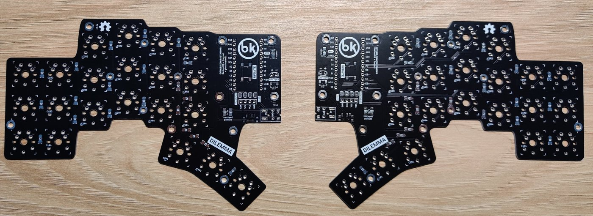
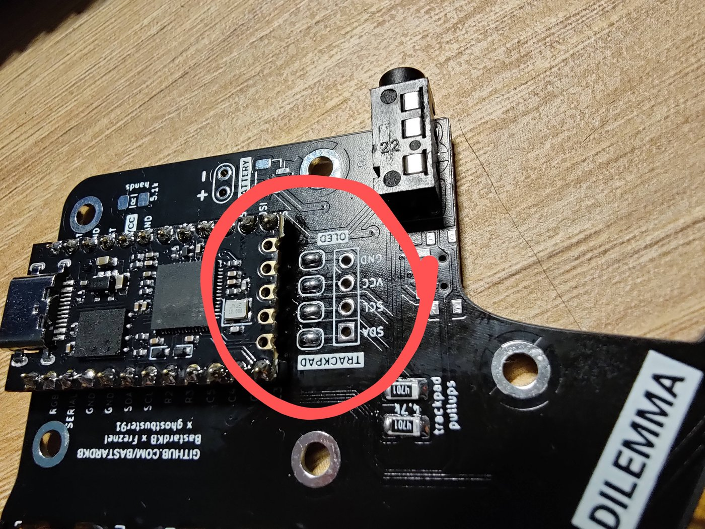
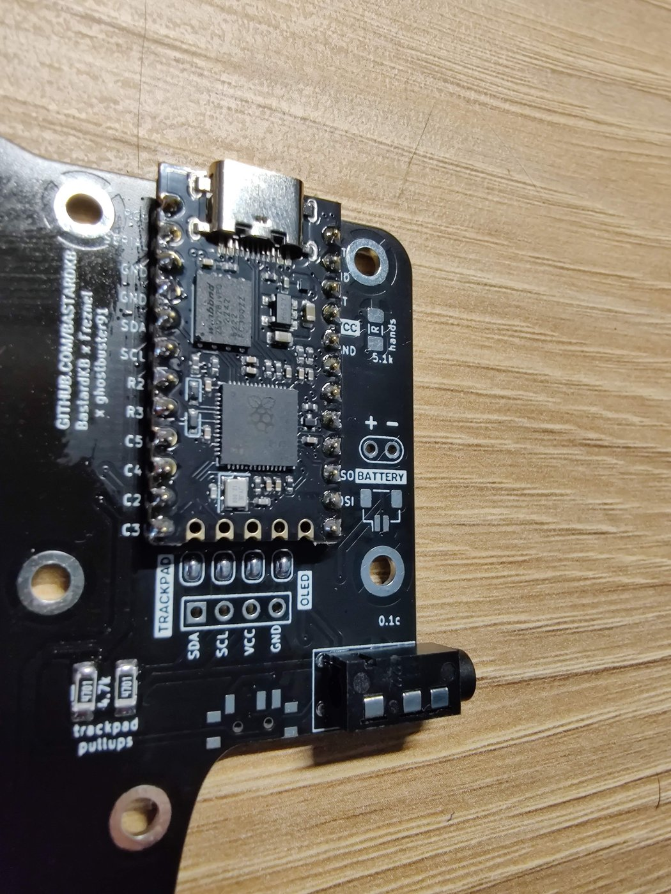
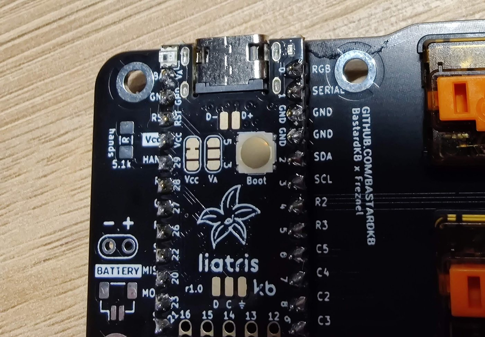

# Dilemma DIY V2 com trackball: guia de montagem

Teclado dividido 3x5+2 com **OLED na metade esquerda** e **trackball na metade direita**, com a bola sobre o controlador, como na versão montada de fábrica.

> **Estado do projeto:** a PCB foi verificada no KiCad, mas nada foi fabricado, impresso ou montado ainda. Os pontos marcados com ⚠️ precisam de teste com as peças em mãos.

## 1. Verificação da PCB

| Item | Resultado |
| ---- | --------- |
| Zip de gerbers | Idêntico à PCB atual do KiCad |
| Conexões | Nenhuma rede sem conexão |
| Em relação à DIY original | Nenhuma trilha removida e contorno igual; apenas J7, suas trilhas e 4 vias adicionados |
| Trackball | SCK, MISO, MOSI, CS, VCC e GND ligados do controlador até J7 |
| OLED | SDA, SCL, VCC e GND disponíveis em O2 através dos jumpers |
| Furos do suporte | H6, H7, H8 e H9 coincidem com as peças de `mechanical/trackball` |

O teste de regras do KiCad (DRC) mostra 23 erros. Nenhum interrompe uma ligação:

- 22 também existem na placa original.
- O outro é a sobreposição de 0,5 mm entre as áreas reservadas de J7 e J3. J3 só é usado com bateria.

## 2. Como encomendar a PCB

Envie `dilemma_3x5_2_trackball_gerber.zip` para a JLCPCB (ou similar).

| Opção | Valor |
| ----- | ----- |
| Camadas | 2 |
| Tamanho | 134,2 x 95,3 mm |
| Espessura | 1,6 mm |
| Montagem (PCBA) | Não |

A placa é reversível: **o mesmo projeto serve para as duas metades**. A quantidade mínima de 5 placas é suficiente.

## 3. Lista de materiais (BOM)

Não confirmei preço nem estoque no AliExpress ou no Mercado Livre. Procure primeiro os itens em negrito, que são os mais difíceis de achar.

### Eletrônica

| Item | Qtd | Observação |
| ---- | --- | ---------- |
| PCB | 2 | Deste projeto |
| **Controlador RP2040 formato Pro Micro** | 2 | Elite-Pi, Liatris ou compatível. Confirme que GP20 a GP23 estão nos pinos `MISO`, `SS`, `SC` e `MOSI` da placa |
| Barra de pinos 1x12, 2,54 mm | 4 | 2 por controlador |
| Conector TRRS PJ320E | 2 | |
| Cabo TRRS (4 polos) | 1 | |
| Diodo 1N4148W, SOD-123 | 34 | 17 por metade |
| Switch MX ou Choc V1 | 34 | |
| Keycap | 34 | |
| Botão de reset 6x6 mm SMD, baixo | 2 | Até 4,3 mm de altura para caber na case |
| Resistor 5,1 kΩ, 1206 | 2 | Opcional: detecção de lado (R1 e R7) |
| Resistor 4,7 kΩ ou 5 kΩ, 1206 | 2 | R3 e R4: só se o OLED não tiver pull-up |

### OLED (esquerda)

| Item | Qtd | Observação |
| ---- | --- | ---------- |
| OLED 0,91" I2C 128x32 | 1 | Pinos no lado curto, na ordem `GND VCC SCL SDA` |
| Barra de pinos 1x4, 2,54 mm | 1 | Muitos módulos já vêm com ela |

### Trackball (direita)

| Item | Qtd | Observação |
| ---- | --- | ---------- |
| **Placa de sensor PMW3360 da Charybdis, com lente LM19-LSI** | 1 | Sua peça reserva; confira a marcação no chip |
| **Bola de 34 mm** | 1 | Vendida como reposição de trackball |
| Rolamento MR63ZZ (3x6x2,5 mm) | 3 | Mesmo tamanho da lista da Charybdis |
| Pino de aço 3 x 8 mm | 3 | Eixos dos rolamentos |
| Fio fino, 28 a 30 AWG | 6 x 10 cm | Use cores diferentes |
| Fita dupla face, cerca de 0,5 mm | 1 | Prende o sensor e define a altura da lente |

### Parafusos e acabamento

| Item | Qtd | Uso |
| ---- | --- | --- |
| Espaçador M3 x 10 mm, fêmea-fêmea | 3 | Eleva o suporte da bola |
| Parafuso M3 x 8 mm, cabeça chata | 3 | Parte de cima do suporte |
| Parafuso M3 x 5 mm, cabeça baixa | 3 | Por baixo da PCB |
| Parafuso M3 x 6 mm | 6 | Case (3 por metade) |
| Porca M3 | 6 | Case (3 por metade) |
| Pé de borracha 10 x 2 mm | 12 | Case |

### Peças impressas em 3D

Total de cerca de 45 g de PLA ou PETG.

| Arquivo | Qtd | Como imprimir |
| ------- | --- | ------------- |
| `mechanical/cases/3x5_2/thin/thin_v1_26.stl` | 2 | Espelhe uma delas no fatiador. Use camada de 0,2 mm |
| `mechanical/trackball/bearing holder.stl` | 1 | Base plana na mesa |
| `mechanical/trackball/trackball holder top.stl` | 1 | Base plana na mesa, com suporte sob a borda |

**Não use** `mods/trackball/` (posiciona a bola fora da placa) nem a case `3x5_3_trackball`: ela não tem abertura para o conector TRRS e sua base fica encostada nas soldas.

## 4. Antes de soldar: qual é a face de cima?

Coloque as duas placas como no teclado, com a área do controlador no centro e os polegares perto de você.

- **Esquerda:** a face **F** fica para cima.
- **Direita:** a face **B** fica para cima.



Todos os componentes das etapas seguintes usam essa referência.

## 5. Montagem da eletrônica

### 5.1 Jumpers do OLED: só na esquerda

Solde **JP1, JP3, JP5 e JP7**, todos na face F da metade esquerda.

> **Risco de curto:** cada pino de O2 tem dois jumpers, um em cada face. Nunca solde os dois lados. Não solde nenhum jumper na metade direita.



### 5.2 Controladores

O mesmo pino do controlador precisa entrar no mesmo furo nas duas metades.

- **Esquerda:** na face de cima, com os componentes do controlador virados para cima.
- **Direita:** na face de cima, com os componentes do controlador virados para a PCB.

Solde os pinos sem soquete, para manter a menor altura possível.

⚠️ Na direita, a USB fica no vão de 2,54 mm entre as placas. Se ela não couber, use pinos mais altos e aumente os espaçadores da etapa 6.3 na mesma medida.

| Esquerda | Direita |
| -------- | ------- |
|  |  |

### 5.3 Demais componentes, nas duas metades

1. Conector TRRS, na face de cima.
2. Diodos, respeitando a polaridade marcada na placa.
3. Switches.
4. Botão de reset na face de baixo: SW37 na esquerda e SW26 na direita.
5. Detecção de lado, se desejar: R1 na face de cima da esquerda e R7 na face de cima da direita.

### 5.4 OLED

Com a face F para cima e o controlador acima de O2, os pinos são, da esquerda para a direita:

`SDA` `SCL` `VCC` `GND`

Um módulo `GND VCC SCL SDA`, com a tela para cima e os pinos voltados para O2, encaixa nessa ordem e fica sobre o controlador.

> **Confira os rótulos do seu módulo antes de soldar.** Alguns trocam VCC e GND, o que pode queimar a tela. Nesse caso, ligue com 4 fios.

⚠️ Teste antes de soldar se o módulo fica acima da USB e dos componentes do controlador.

## 6. Montagem do trackball

### 6.1 Rolamentos

1. Coloque um rolamento em cada um dos 3 garfos de `bearing holder`.
2. Passe um pino de 3 x 8 mm por cada garfo. Se o furo estiver apertado, passe uma broca de 3 mm.
3. Confirme que os rolamentos giram livremente.

### 6.2 Sensor

O sensor da Charybdis tem cerca de 42 mm e invade os furos H7 e H8. Por isso, o suporte usa só **H6, H7 e H9**.

1. Faça um teste a seco: encaixe a lente na janela do suporte, com o conector de 6 pinos do sensor do lado de J7.
2. ⚠️ Confirme que a lente entra na janela com o lado maior alinhado ao lado maior da janela. **Faça isso antes de cortar a placa.**
3. Marque na borda do sensor a posição de H7, olhando pelo furo do suporte.
4. Lime um entalhe de cerca de 3 mm nessa borda. O cobre mais próximo fica a cerca de 6 mm do centro do furo.
5. Solde os 6 fios pelo verso do sensor e corte as pontas rente no lado da bola.
6. Prenda o sensor sob o suporte com a fita dupla face, só na borda da placa.

### 6.3 Fixação na PCB e fiação

Grave o firmware da metade direita (etapa 7) **antes** de instalar o suporte, porque ele pode bloquear o cabo USB.

| Sensor | J7 |
| ------ | --- |
| 3.3V (ou 5V em placas antigas) | `V+` |
| GND | `G` |
| SCK | `CK` |
| MISO | `MI` |
| MOSI | `MO` |
| SS | `CS` |

1. Solde os fios diretamente em J7, pela face de cima, sem barra de pinos.
2. Encaixe os 3 espaçadores de 10 mm em **H6, H7 e H9**. **Deixe H8 vazio.**
3. Prenda cada espaçador por baixo, com um parafuso M3 x 5 mm de cabeça baixa.
4. Apoie `bearing holder` nos espaçadores. O padrão dos furos só encaixa em uma posição.
5. Coloque `trackball holder top` por cima e prenda com 3 parafusos M3 x 8 mm de cabeça chata.
6. Coloque a bola e gire por cerca de 30 segundos para assentar.

⚠️ **Os 10 mm são uma estimativa**, e o chip do sensor fica virado para o controlador. Confirme que eles não se tocam e use um espaçador maior se precisar. O topo da bola fica a cerca de 50 mm da PCB, cerca de 10 mm acima da versão de fábrica.

## 7. Firmware (QMK)

> Estas configurações **ainda não foram compiladas nem testadas.**

Parta de `keyboards/bastardkb/dilemma/3x5_2/splinky` no QMK e troque o driver do trackpad pelo do trackball.

`rules.mk`:

```make
POINTING_DEVICE_ENABLE = yes
POINTING_DEVICE_DRIVER = pmw3360
OLED_ENABLE = yes
```

`config.h`:

```c
#define SPLIT_POINTING_ENABLE
#define POINTING_DEVICE_RIGHT

#define SPI_DRIVER SPID0
#define SPI_SCK_PIN GP22
#define SPI_MOSI_PIN GP23
#define SPI_MISO_PIN GP20
#define PMW33XX_CS_PIN GP21

#define I2C_DRIVER I2CD1
#define I2C1_SDA_PIN GP2
#define I2C1_SCL_PIN GP3

// Só se R1 e R7 estiverem instalados na face de cima
#define SPLIT_HAND_PIN GP29
#define SPLIT_HAND_PIN_LOW_IS_LEFT
```

- `halconf.h`: `HAL_USE_SPI` e `HAL_USE_I2C` como `TRUE`.
- `mcuconf.h`: `RP_SPI_USE_SPI0` e `RP_I2C_USE_I2C1` como `TRUE`.
- O sentido do cursor depende da montagem: ajuste com `POINTING_DEVICE_ROTATION_*` e `POINTING_DEVICE_INVERT_*`. Se a tela ficar invertida, gire-a em `oled_init_user`.

Grave cada metade separadamente: segure reset, conecte a USB e copie o arquivo `.uf2`.

## 8. Testes e fechamento

Teste cada etapa antes de fechar a case.

1. **Sem energia:** use o multímetro para confirmar que não há curto entre `V+` e `G` em J7, nem entre VCC e GND em O2.
2. **Metade esquerda sozinha, pela USB:** teclas e OLED.
3. **Metade direita sozinha, pela USB:** teclas e trackball.
4. **As duas com o cabo TRRS:** teclas dos dois lados, cursor e OLED.
5. **Altura da lente:** se o cursor falhar, ajuste a espessura da fita.
6. **Case:** coloque porcas e parafusos M3 x 6 mm em H1, H2 e H5 e cole os pés de borracha.

> **Nunca conecte ou desconecte o cabo TRRS com a USB ligada.** Ele leva 3,3 V e pode danificar os controladores.

## 9. Problemas comuns

| Sintoma | Verifique primeiro |
| ------- | ------------------ |
| Controlador não liga | Curto em J7 ou O2; jumpers soldados nas duas faces |
| Colunas ou linhas falham na direita | Controlador invertido: confira os rótulos da placa |
| Cursor parado | Ordem dos fios em J7 e driver `pmw3360` |
| Cursor falha ou treme | Altura da lente; sujeira na lente ou na bola |
| Cursor no sentido errado | Rotação e inversão no `config.h` |
| OLED apagado | Ordem dos pinos, jumpers e endereço I2C |
| Bola travando | Rolamentos e eixos; rebarbas de impressão |
