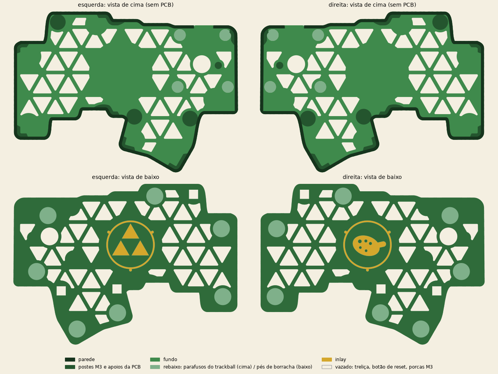
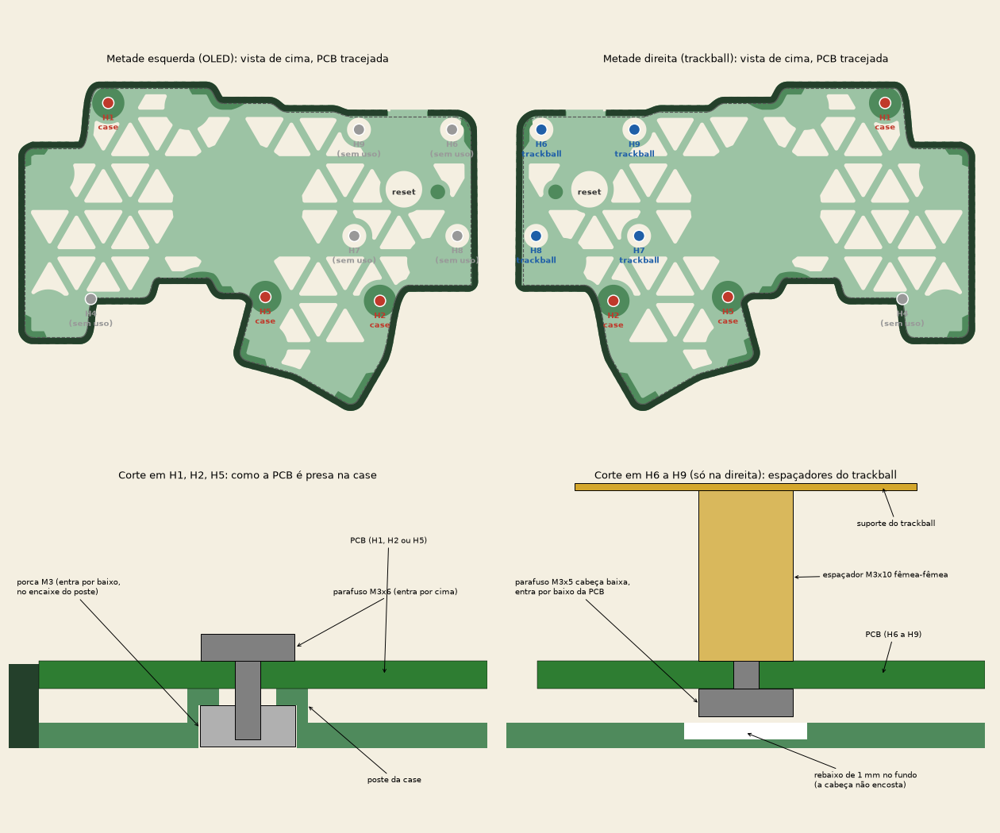

# Case "Ocarina" para o Dilemma DIY 3x5_2 / 3x5_2_trackball

Case temática inspirada em Ocarina of Time para o Dilemma DIY 3x5_2 / 3x5_2_trackball.

A `thin` (`../thin/thin_v1_26.stl`) serve só de base de medidas. Dela vêm o contorno, a parede com a abertura da USB, os postes M3 com encaixe de porca (H1, H2, H5) e os apoios da PCB junto à parede. O resto foi desenhado a partir da PCB.

> **Estado:** os modelos foram gerados e verificados como sólidos fechados e válidos, mas **ainda não foram impressos**. Faça um teste com a PCB antes de imprimir a segunda metade.

## Furos e rebaixos

Cada furo tem uma função. Nenhum é decorativo.

A PCB é presa por 3 parafusos M3 x 6 em H1, H2 e H5. Eles entram por cima da PCB e rosqueiam em porcas encaixadas por baixo nos postes da case, como na `thin`. H4 não é usado: ele fica na borda da PCB, colado na parede.

| Furo | Onde | Função |
| ---- | ---- | ------ |
| Redondo vazado, 11 mm | Ao lado do controlador | Botão de reset, que fica na face de baixo da PCB e passa pelo fundo. Também permite apertar o reset por baixo |
| Quadrado vazado, dentro de 3 postes | H1, H2, H5 | Porcas M3 dos parafusos da case (iguais aos da `thin`) |
| Rebaixo redondo por cima, 7,2 mm e 1 mm de fundo | H6, H7, H8, H9 | Cabeças dos parafusos de cabeça baixa dos espaçadores do trackball. O fundo fica fechado porque o parafuso entra por baixo da PCB, e a cabeça fica no vão entre a PCB e a case. Com o sensor da Charybdis, o guia deixa H8 vazio. Na metade esquerda os 4 ficam sem uso |
| Rebaixo redondo por baixo, 10,5 mm e 1 mm de fundo | 7 pontos | Pés de borracha de 10 mm. Os pés que ficavam sobre H6 e H8 foram movidos |
| Pilar redondo, 4,4 mm | Ao lado do botão de reset | Apoio da PCB. Substitui a nervura retangular da `thin`, no mesmo lugar |
| Rebaixo de 0,6 mm por baixo | Medalhão central | Encaixe do inlay |
| Recorte na parede, 12 mm | Borda de cima, perto do controlador | Plugue USB (igual à `thin`) |
| Nenhum | Conector P2/TRRS (J2), na borda lateral | O conector fica sobre a PCB, cujo topo (5,1 mm) passa da parede (4,9 mm). A boca dele avança cerca de 1 mm além da parede, então o plugue entra por fora sem tocar na case (igual à `thin`) |

## Desenho

- **Fundo:** treliça de triângulos com barras de 2,2 mm, presa a uma borda maciça de 2 mm junto à parede. Onde a treliça encontra a borda, os pés ou os postes, os triângulos que ficariam pequenos ou estreitos (menos da metade de um triângulo inteiro, ou menos de 4 mm de largura) são preenchidos. Não há hastes soltas nem frestas.
- **Medalhão de 39 mm:** três triângulos num anel na esquerda, uma ocarina num anel na direita.
- **Parede externa:** faixa de triângulos alternados, gravada com 0,5 mm de profundidade.
- **Espelhamento:** arquivos `left` e `right` prontos. **Não espelhe** no fatiador.

A folga entre o fundo e a PCB é a mesma da `thin`: cerca de 2 mm, do topo do fundo (1,5 mm) ao topo dos postes (3,5 mm). O medalhão é maciço, então **corte rente as pernas dos switches** que ficam sobre ele.

## Arquivos

| Arquivo | Uso |
| ------- | --- |
| `case_left.stl`, `case_right.stl` | Cases, com o rebaixo do inlay |
| `inlay_left.stl`, `inlay_right.stl` | Inlays, 0,08 mm menores por lado para encaixar no rebaixo |
| `build_ocarina_case.py` | Script que gera tudo (Python com `numpy scipy trimesh manifold3d shapely networkx`) |

## Como imprimir

- **Cases:** com o fundo na mesa, sem suporte. Camada de 0,2 mm, 3 a 4 perímetros. Ative a compensação de "pé de elefante" (cerca de 0,1 mm), senão o rebaixo do inlay fica estreito.
- **Inlays:** deitados na mesa, em dourado. Têm 0,6 mm de altura (3 camadas de 0,2 mm). Para o anel fino sair bem, use bico de 0,4 mm e velocidade baixa na primeira camada.
- **Montagem:** encaixe o inlay no rebaixo do medalhão e fixe com algumas gotas de cola instantânea. Na esquerda, o inlay sai em 4 peças: o anel com os pontos e os três triângulos. Encaixe o anel primeiro. Na direita são 2 peças: o anel com os pontos e a ocarina.

## Cores sugeridas

| Peça | Cor | Filamento |
| ---- | --- | --------- |
| Cases | Verde floresta escuro | PLA fosco (matte) |
| Inlays | Dourado | PLA silk dourado |
| `trackball holder top` | Dourado | PLA silk dourado, combinando com os inlays |
| `bearing holder` | Marrom ou preto | Qualquer PLA, quase não aparece |
| Bola de 34 mm | **Azul** | É a "ocarina" da composição |

Alternativa mais sóbria: case em marrom madeira (PLA com fibra de madeira), inlays dourados e bola azul.

## Keycaps e switches

São 34 teclas: 30 alfas e 4 de polegar.

| Grupo | Cor | Ideia |
| ----- | --- | ----- |
| 30 alfas | Creme ou bege | Contrasta com a case verde |
| 1 polegar de cada lado | Azul | O botão **A** do controle, nota da ocarina |
| 1 polegar de cada lado | Amarelo | Os botões **C**, as outras notas |
| Home row (F e J), opcional | Verde | Marca a posição das mãos |

Keycaps sem legenda combinam com teclados de 34 teclas. Para um toque extra, use legendas ▲ ▼ ◀ ▶ e "A" nos polegares.

| Se usar | Keycaps | Switches |
| ------- | ------- | -------- |
| **Choc V1** (recomendado: combina com a case fina) | PBT perfil MBK ou CFX, sem legenda, nas cores acima | Kailh Choc Red Pro (linear, leve) ou Brown (tátil) |
| **MX** | PBT perfil DSA ou XDA, sem legenda | Linear tipo Gateron Yellow, ou Kailh Box Jade (clicky e verde) para entrar no tema |

Não confirmei preço nem estoque desses itens.

## Aviso

Os desenhos dos medalhões são originais e apenas inspirados no jogo. Não são arte oficial da Nintendo. Use a case para fins pessoais.
